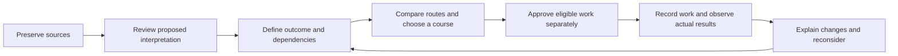

# The complete 8BALL build

Consolidation snapshot: 15 October 2026. **8BALL is the fixer application; ENDSTATE is the reusable engine underneath it.** The application helps an operator understand a situation, define the required result, compare conditional routes, choose a course, record authorised work and reconsider when evidence changes.

The current build combines the application and its latest fixes from `486c85ec07a05c7af8b30b142d2ad19faf402e25` with the consolidated documentation/research from `0ee5834c0745640369f5a538b770c346f234232a`. They are now consolidated in **main**, with the integration history retained on `integration/v02-consolidated-20261015`. The owner explicitly authorized this merge; GitHub PRs #1, #2 and #3 show Merged. This is not a deployment or V0.2 acceptance decision. [The current handoff](HANDOFF.md) records subsequent verification and publication outcomes; earlier no-merge instructions remain historical records of the authority at those checkpoints.

Start with [START-HERE](../../START-HERE.md), then use this overview to understand the product. The [master PRD](../PRD.md), [roadmap](../ROADMAP.md), [system architecture](../architecture/ENDSTATE-SYSTEM.md) and [canonical delivery tracker](PROGRESS.md) provide the requirements, boundaries and actual task states.

## How the application works

The operator can add attributed source excerpts or preserve longer originals in Source Desk. Manual entry, rules capture, a selected playbook or an optional model can propose structure. Human review decides what enters the case; accepting an extracted claim does not establish that it is true.

The outcome graph records success conditions, actions, prerequisites, constraints and verification requirements. ENDSTATE calculates candidate routes under those declared inputs. The operator can compare alternatives and record a Chosen Course with a rationale. That choice is separate from approving an eligible action. Recording completion is separate again from evidence that its intended result occurred.

New reviewed evidence can change readiness, questions, routes and the reasons to reconsider a course. What Changed explains the recorded difference. What If runs an isolated hypothetical comparison. Neither a model proposal nor a simulation can silently become live evidence or execution authority.

## What is built

| Workspace area | What the operator can do |
| --- | --- |
| Agency command and Situation room | Open/create fictional cases; inspect the exact target, current evidenced state, blockers, immediate work, questions and chosen course. |
| Evidence & claims, Source Desk | Import UTF-8 text/Markdown originals; inspect duplicate candidates; search/select exact passages; preserve original/excerpt lineage; review sources and separately record observations. |
| Identity & deadlines | Review a quoted identity mention without merging actors; interpret a date with an explicit anchor/timezone; preview and explicitly apply a scheduling change with retained history. |
| Intake review and Intelligence | Request an available proposal method; inspect actual provider/runtime status and job stages; cancel work; accept, edit or reject reviewable proposals. Failed model validation remains a failure. |
| Plan Studio and Playbooks | Author conditions/actions and nested logic; inspect a proposed graph change on a copy before committing; deliberately select human-authored starter structures. |
| Situation map | Explore actual records in Connections, directed Outcome flow or Records; filter/focus neighbourhoods and inspect source/history and exact logic without changing the case. |
| Ways through, Plan Review and Chosen Course | Compare conditional alternatives; inspect constraints, unknown waits and verification needs; record six-part human plan judgement; preserve the operator's selected course and reasons to reconsider it. |
| Open questions, Decisions and Actions & approvals | Resolve questions with explicit records; preserve decision rationale and evidence; approve eligible work at the current revision and record work performed outside 8BALL. |
| Timeline and What changed? | Inspect the case chronology and actual state, route, constraint and approval changes. |
| Emergent insights and What if? | Review bounded case patterns/hypotheses and their history; explicitly create a verification question; compare hypothetical conditions or constraints while preserving live state. |
| Decision trail and Client brief | Inspect/export the audit and review history; prepare an operator-reviewed client projection. The brief is not an authenticated client portal. |
| What's new and Build discoveries | Read the canonical product changelog and preserved development discoveries, including deferred ideas. These are separate from a client's case history. |

These features share the same local black/graphite workspace. Sources, facts, hypotheses, reviews, chosen courses, approvals and completed actions retain different meanings. Unknown is not false; conflicting active evidence remains disputed. Graph position does not prove causation, influence or authority.

The latest fixes clarify model drafting roles without weakening final verification, retain rejected extraction output for diagnosis, preserve keyboard focus through graph redraws, and prevent an older refresh from replacing a newer navigation choice. Their original failures and verification records remain available.

## What runs today, and what AI still needs

The local application runs for a trusted single operator using fictional/test cases. Manual case/graph entry, deterministic rules capture, explicitly selected catalogue playbooks, planning, source review, scenarios and audit/export work without a model. [The operator runbook](../v2/RUNBOOK.md) explains the existing controls; use the current consolidated checkout rather than older branch instructions in historical documents.

Optional Ollama and Hugging Face adapters can request extraction and graph proposals when the chosen runtime/model and required permissions are deliberately configured. The adapter's existence, a configuration value or listed weights does not prove successful inference or useful output. ENDSTATE itself is not an LLM.

Reliable real-model source-to-plan generation is still unaccepted. The preserved [27 September Qwen experiment](../evidence/qwen-baseline-2026-09-27.json) produced three schema-valid extractions and a rejected graph; all live states stayed unchanged. The recent prompt correction and historical replay are software evidence, not a fresh model-quality pass. The known four generation cases remain a development regression set, not an independent holdout.

Models propose; human-reviewed commands commit. No connector here sends messages, makes calls, pays anyone or executes a plan. Local job cancellation prevents further stages and publication, but cannot recall an external request already sent. Hosted processing requires selected configuration and explicit permission; credentials stay outside source, chat and review exports.

## ENDSTATE's role

The shared Python engine owns generic evidence/state contracts, dependency and constraint calculation, route scheduling, questions, scenarios, change explanations, plan inspection and course reconsideration. 8BALL owns the fixer-facing experience, case services, storage, review transactions, source handling and provider orchestration. Compatibility adapters retain earlier imports, persistence and audit contracts.

ENDSTATE V0.1 is verified for its **internal core** scope, including installation/compatibility of the internal package. That does not establish a public supported SDK, hosted engine service or another industry application. Neutral/sales/support test fixtures demonstrate bounded reuse of the same kernel, not launched products. See [ENDSTATE contracts](../endstate/CONTRACTS.md), [internal packaging](../endstate/PACKAGE.md) and [the system map](../architecture/ENDSTATE-SYSTEM.md).

The planner works within declared catalogues, evidence and search/scheduling limits. Its schedules are conditional calculations; unknown external waits remain unknown. A route count or a valid graph is not a probability of success, proof of semantic correctness or a guarantee that every real-world option was found.

## Verification and acceptance

At this consolidation snapshot the sole [canonical ledger](progress.json) records **8BALL V0.2: 10/20 required scopes verified** and **ENDSTATE V0.1: 5/5 internal-core scopes verified**. These are scoped acceptance items, not an estimate of time remaining or commercial readiness. This overview is not another editable status ledger.

The [consolidated native receipt](../evidence/main-consolidation-native-2026-10-15.json) records the new combined source at `6b57a4503c9e88b4aa97f36b4a24d36ecd82d31f`: **964 source tests, 964 installed-kernel tests and 384 native browser checks across all eleven suites passed**. Source/artifact inspection returned valid=true/run_status=passed before final documentation-only receipt edits. All 74 discoveries, both original research variants and all prior histories are preserved.

The latest prior [source-bound native receipt](../evidence/provider-failure-native-2026-10-15.json) covers tested code `294ff578b963dcf50cc8d91d060182894773d159`: **964 source tests, 964 installed-kernel tests and 384 native Chromium checks across eleven suites passed**. It covers the earlier code at its recorded source hash. It is not a passing result for this new integration tree, an actual-model study or human acceptance. The initial failed cumulative run is preserved in [its separate receipt](../evidence/provider-failure-native-failed-2026-10-15.json).

Remaining required evidence includes selected real-provider generation and the full provider journey/lifecycle, independent professional source/plan evaluation with prospectively approved criteria, human screen-reader/platform review, owner visual/mobile review and representative dense-case graph comprehension. The [review pack](review/README.md) contains concrete unperformed templates, including the original twenty-step human journey. Creating or filling a software-generated sheet cannot supply independent human sign-off. The [closeout guide](V02-CLOSEOUT.md) explains the required scopes; newer source/evidence and the canonical ledger control current claims.

The build is not ready for confidential agency data. Identity/matter permissions, a production evidence vault, protected client/specialist collaboration and agency operations belong to the later [production security gate](../v2/PRODUCTION-SECURITY.md). No deployment is performed by consolidating the repository.

## The preserved full picture

The original PRDs, prior source/test evidence, changelog, decisions and development discoveries remain available. The consolidated [research archive](../reference/endstate-handoff-2026-09-24/00-START-HERE.md) preserves all **19 files** of the supplied variant and its manifest; the older archive variant and operations/recovery history retain separate provenance. [The context manifest](context-manifest.json) records that documentation checkpoint's original hashes and known gaps; it is historical preservation evidence, not a claim that today's runtime is unchanged from September.

The long-term [vision addendum](../strategy/ENDSTATE-VISION-ADDENDUM.md), [future roadmap mapping](../strategy/ROADMAP-INTEGRATION.md), [research register](../research/ENDSTATE-REGISTER.md) and [experiment queue](../research/ENDSTATE-EXPERIMENTS.md) explain prediction, possible worlds, stress testing, learning and future domain packs. These remain deferred implementation. Consolidation adds the full context; it does not add those capabilities to the runtime, start a Sales application, install research projects or reduce V0.2's existing acceptance requirements.
