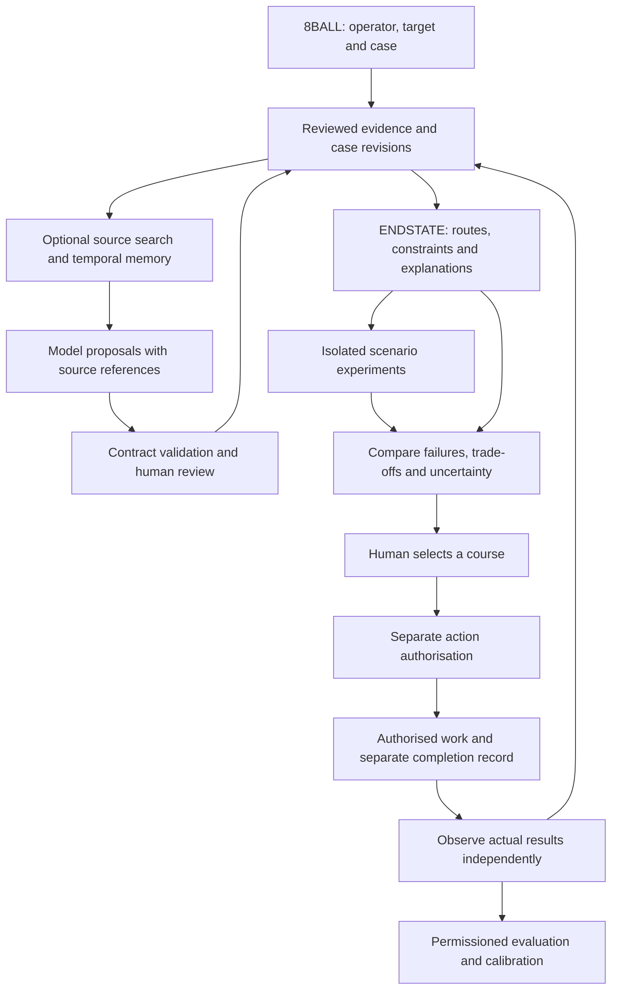

# ENDSTATE evolution: one product, replaceable components, measured decisions

16 October 2026. Requested GitHub research and proposed implementation sequence. Baseline: consolidated main `d7d36b842464d7ad0e974a59730a682f1739fccf`. This supplements the original PRDs; it does not change their acceptance requirements. [Source inspections](../research/GITHUB-COMPONENTS-2026-10-16.md), [complete capability map](../research/github-2026-10-16/capability-map.md), [canonical task ledger](../delivery/progress.json).

## What we want to achieve

**8BALL should help a fixer turn a difficult, changing situation into an evidenced resolution. ENDSTATE should supply the reusable reasoning underneath it.** The operator should be able to:

1. Bring together documents, messages, people, constraints and unknowns, with sources visible.
2. Agree the desired outcome, acceptable fallbacks, prohibited actions and who has authority.
3. Find several meaningful routes, identify missing information and understand the trade-offs.
4. Rehearse adverse scenarios: refusal, delay, lost authority, unavailable resources, contradictory evidence and reactions to proposed actions.
5. Compare routes by feasibility, costs, dependencies, reversibility and performance under those explicit scenarios.
6. Choose a course, authorise eligible actions, watch for changes and reconsider with reasons.
7. Verify what actually happened, then improve future recommendations using permitted outcome data.

The ambition includes forecasts and multi-actor simulation. Credible forecasts require relevant observed outcomes and evaluation. A simulator can explore possibilities before that data exists, provided its results remain explicitly hypothetical.

## What we already have

The current app has the Situation Room, source originals/excerpts, evidence and uncertainty records, identity/deadline review, Connections, Plan Studio, conditional alternative routes, Plan Review, Chosen Course, Emergent Insights, isolated What If scenarios, approvals, local analysis jobs and audit/export. ENDSTATE is already a separately installable internal calculation package.

The latest recorded software acceptance is 964 source tests, 964 installed-kernel tests and 384 native browser checks at the tested consolidation commit. These are **historical results**, not tests rerun by this research. V0.2 remains **10 of 20 required acceptance scopes verified**; ENDSTATE V0.1 is **5 of 5 internal scopes**. These counts do not estimate engineering time or production readiness.

The immediate gaps are reliable actual-model generation, independently evaluated source/plan quality, the full actual-provider journey and genuine human accessibility/usability acceptance. Source has been merged into main; release acceptance and deployment remain separate.

## How the components fit

ENDSTATE remains the owner of its typed calculation contracts. The application owns case access, persistence, jobs and human authority. External libraries provide bounded services through adapters. Memory indexes, synthetic worlds and agent messages cannot write facts or approvals directly.

We should combine **capabilities**, selecting one implementation per need after comparison. MiroFish already uses OASIS; installing both as separate simulation engines would duplicate much of the same stack. AgentSociety and Mesa are alternative approaches to evaluate. LangGraph, Temporal and the existing job runner solve different orchestration problems and should not all be added by default.

## Recommended choices

These are recommendations for staged experiments, not claims of completed integration. Exact versions, inspected files, licences and limitations are in the source register.

| Need | Recommendation | What this lets the operator achieve | Remaining work |
| --- | --- | --- | --- |
| Understand sources and generate plans | Keep current ENDSTATE compiler; evaluate an explicitly selected Qwen/DeepSeek or other suitable endpoint | Draft case structures and genuinely different routes from new sources | Provider adapter if needed; unchanged generation fixtures; independent semantic evaluation |
| Read PDFs, scanned pages and office documents | Evaluate **Docling** after source/vault contracts | Bring richer documents into Source Desk with page/region references | Preserve original bytes and derived-text maps; OCR review, model downloads and file isolation |
| Remember changing people/events/relationships | Compare existing case search with **Graphiti**; consider **Zep Cloud** as the managed alternative | Retrieve what was said, when it applied and what later contradicted it | Matter isolation, source attribution, retention/deletion and no automatic factual promotion |
| Rehearse reactions | Evaluate **MiroFish/OASIS** for social-response cases | Expose possible objections, contagion and second-order reactions | Map actual environments/actions to the domain; bound costs; independently assess usefulness |
| Run general controlled scenarios | Start with existing What If/Plan Review; compare **Mesa** for rule-based actors and **AgentSociety** for broader LLM environments if needed | Repeat and compare declared alternative worlds | ENDSTATE branch contracts, authored baselines, actor/environment assumptions and replay |
| Check schedules and resource feasibility | Evaluate **OR-Tools CP-SAT** only where the current planner demonstrably falls short | Find constraint-feasible schedules and explain conflicts under declared inputs | Translate signed AND/OR prerequisites, resources, time and authority faithfully; preserve solver limits/status |
| Coordinate proposer, critic and assessor roles | Keep the current staged compiler first; consider **LangGraph** if the workflow becomes complex | Run bounded specialist passes and pause for review | Role contracts, retries, budgets and revision-safe publication; extra agents do not establish independence |
| Compare model configurations | Keep frozen project evals; optionally add **promptfoo** for repeatable experiments | Compare outputs, failures, latency and usage across selected models | Independent labels and thresholds; export into existing receipts; no live calls by default |
| Explain and inspect model runs | Retain project receipts; consider optional observability tooling after a licence/data review | Trace which inputs, prompts and model calls produced an answer | Redaction, retention and permission-aware logs; a trace is not proof of accuracy |
| Watch incoming events reliably | Extend current event contracts; evaluate **Temporal** when durable multi-worker operations justify it | Resume permitted work after failures and surface relevant changes | Idempotency/outbox, cancellations, timeouts and paid-call reconciliation remain application work |
| Secure an agency pilot | **PostgreSQL**, OIDC identity such as **Keycloak**, then **OpenFGA** if relationship permissions justify a service | Separate clients/matters, collaborate and revoke access | Evidence vault, API enforcement, backups, client projections, operational ownership and adversarial tests |
| Learn which interventions work | Simple statistical baselines first; later **DoWhy/EconML** where data supports their assumptions | Estimate task-specific effects and test assumptions against real outcomes | Authorised longitudinal data, causal identification, confounding review and held-out evaluation |
| Explore trade-offs and sensitivity | Existing route comparisons first; optional **pymoo/SALib** for sufficiently complex numeric models | See Pareto alternatives and which explicit inputs most affect a result | Defensible objectives/ranges; sensitivity is not a real-world success probability |
| Judge whether a proposed path is useful | Deterministic checks plus independent professional rubric; evaluate **JEV** as an optional model assessor | Surface omissions, target drift and unsupported assumptions | Exact JEV API/model documentation and task-fit evidence; current adapter only classifies text |

**Preferred first combination:** existing 8BALL/ENDSTATE + one evaluated model provider + the existing evaluation harness + an authored scenario runner. Then compare one simulation adapter; test a memory adapter only if existing retrieval demonstrably needs improvement. After V0.2, secure B03/ES02 implementation and approved fictional Lab experiments can proceed as separate workstreams. Production identity/storage/event infrastructure precedes private-case use. This keeps the first useful system small enough to understand and test.

## Zep Cloud, plainly

Think of Zep Cloud as a managed notebook and relationship index for AI applications. The app sends permitted documents/messages; Zep organises information over time and retrieves relevant context for later model calls. It is a separate hosted service from Qwen or DeepSeek.

**Graphiti** is Zep's open-source temporal graph library. Self-hosting it means operating its graph database and configuring extraction/embedding models ourselves. Software licence cost, model inference cost and hosting/maintenance cost are different. Self-hosting does not automatically keep all processing local when its models use external APIs.

Current MiroFish requires the Zep Cloud APIs and rejects a custom Zep base URL. Replacing Zep Cloud with Graphiti would require an adapter for its ingest/status/query/deletion operations, plus compatibility tests. It is not a configuration-only replacement. The current `getzep/zep` repository is examples/integrations; its older Community Edition is no longer supported according to its README.

For 8BALL, retain reviewed evidence and revisions as the authoritative case record. A future Zep/Graphiti index should be derived and rebuildable, with source links and case access enforced. “Remembered by an AI” must not become “verified as true.” We do not need to buy or install Zep to finish V0.2.

## The build sequence and exit conditions

### 1. Close the current V0.2 — B02 / ES01 / existing ES03 provider work

Configure one named provider/model, transmission scope and bounded test budget using secure settings. Run the unchanged four generation fixtures; retain raw successes/failures, identity, prompt/schema versions, usage and timings. Fix demonstrated defects without repairing the measured outputs or substituting catalogue plans. Run actual cancellation, stale-result and interruption checks and the complete native provider journey.

Obtain the independent professional source/plan evaluation and the owner's end review using the existing review pack. The owner can perform owner usability/visual checks; any professional/independence requirements still need the appropriate reviewer. Human review remains a real decision, not an agent-signed result.

**Exit:** every existing required B02 acceptance item has matching evidence. Release/deployment is a separate decision. A model endpoint is the first unresolved external input; it can be remote, so model weights need not be installed in this cloud environment.

### 2. Build secure case operation and durable changes — B03 / ES02

Introduce authenticated identities, matter-scoped access, protected originals/derived documents and recovery. Define event occurrence/receipt/review times, deduplication/order, immutable input snapshots, outbox publication and cancellation. Extend existing course/revision checks rather than introducing a competing truth store. Add authorised inbound connectors incrementally.

Treat full mandate, concessions, commitments and confirmation windows as explicit scope decisions within their existing optional task homes. Access to a case and permission to execute a particular action are separate.

**Exit:** cross-matter denial, revocation, duplicate/out-of-order delivery, restart/recovery and stale publication tests pass; qualified pilot criteria are met before confidential use. Synthetic Lab work can proceed in isolation before this stage completes; private-case integrations cannot.

### 3. Make multiple scenarios a first-class experiment — Lab A–C; F-01..04

Extend existing What If/Plan Review with a versioned scenario manifest. Start every comparison from the same immutable case/target revision. Declare which inputs may vary, which are fixed, relevant premise links, actor/action limits and stop conditions. Preserve each branch's assumptions, raw results, validation and failure causes.

Start with hand-authored refusal, delay, resource loss, withdrawn authority, conflicting evidence and changed-deadline families. Show useful questions and reconsideration reasons alongside route comparisons. Return separate feasibility, cost, time, failure exposure and uncertainty fields; avoid one unexplained “best decision” score.

**Exit:** deterministic replay where applicable; zero live-state mutation; clear coverage limits; independent assessment of useful missed failures, false assumptions and operator burden against today's Plan Review.

### 4. Compare scenario-generation and memory candidates — Lab D and B04 retrieval research

Run small fictional comparisons: current planner; planner plus authored scenarios; planner plus a bounded external simulator. Use MiroFish/OASIS for a social-response case. Use a rule-based Mesa prototype or an AgentSociety prototype only where a general environment needs it. Preserve Simulatrex's earlier research and refresh its specific useful patterns; it remains an alternative, not another mandatory engine.

Compare existing source search with Graphiti or Zep retrieval on separate authorised cases. Measure recall of relevant original passages, wrong identity merges, stale/retracted retrieval, case leakage, corrections, latency and operating cost. Simulation memory must remain distinguishable from real-world source memory.

**Exit:** a predeclared, independently reviewed improvement in useful scenario discovery over the simple baseline, acceptable operational cost and a licence/dependency decision. This stage does not establish multi-actor forecasting performance. Graduate only the winning component behind its typed adapter. A failed or unnecessary candidate stays documented and uninstalled in product runtime.

### 5. Improve route choice and forecasts — ES03 / B04; Lab E

Build a layered assessment: ENDSTATE checks references and declared constraint/authority rules, with the application enforcing authenticated permissions and revisions; optional OR-Tools checks larger scheduling models; an evaluated model critiques omissions and target alignment; an independent professional assesses meaningfulness; the authorised operator chooses. Recorded authority still needs evidence; software cannot establish a person's real-world mandate by itself.

Define an initial forecast target such as response delay or missed delivery, with an explicit horizon. Collect permitted observations with historical cut-offs. Compare simple frequency/statistical baselines before LLM forecasts; assess calibration or interval error, abstention, drift and relevant subgroups. Add causal methods only when the data and assumptions support the intervention question.

After the simpler single-event forecasting and authored-scenario baselines exist, Lab F can test whether multi-actor simulation improves decisions beyond them. Earlier fictional adapter work is plumbing and scenario discovery, not a completed Lab F forecast evaluation.

**Exit:** useful held-out results, auditable uncertainty, reversible model/version selection and later-outcome tracking. Ten favourable simulations are ten synthetic runs; they are not evidence of a real-world 100% success rate. Multiple models agreeing also does not establish correctness.

### 6. Evolve into governed expertise and reusable packs — B04 / ES04 / B10 / ES10

Professional review improves playbooks; permitted precedents and correction replay improve prompts/retrieval or calibration through separate evaluated changes. Define versioned domain packs for vocabulary, actions, policies, proof rules, prompts, predictors and fixtures. Prove reuse with adjacent-domain fixtures before approving another product.

**Exit:** measured fixer benefit, permissioned learning, pack compatibility, support/recovery procedures and a scoped release decision. A Sales/SDR application remains a later product choice. ENDSTATE can remain embedded; we should build an SDK, API or MCP surface only for a demonstrated consumer need.

## Concrete first simulation demonstration

Use the existing fictional conference-chair situation. Target: sufficient suitable chairs and written venue acceptance. Compare on-site spares and an external hire route. Hold the target and constraints fixed; vary stock availability, supplier delay, venue refusal, budget and authority withdrawal.

The operator should see: which route fails under which assumption; which unknown is most useful to resolve; whether a fallback is available within authority; what must be verified at the end; and why new evidence would prompt reconsideration. A later multi-actor adapter may propose additional reactions, each labelled synthetic and checked against permitted actor/action types.

Success for this demonstration is a defensible comparison with preserved evidence and less review burden. It is not a claim to predict the conference's real outcome. Keep this research demonstration separate from the frozen generation regression and from the independent held-out evaluation.

## What we still need to build ourselves

Upstream projects do not supply the correct client mandate, lawful available actions, real actor authority, case-specific causal prerequisites, proof of resolution, chosen-course policy or an independently labelled fixer dataset. ENDSTATE's differentiating work is the contract joining these pieces with evidence, human decisions and traceable change.

We also own integration and operations: originals-to-extracted-text lineage, model permission and budgets, case isolation in search/logs/queues, failure attribution, revocation, migrations, backup restoration and human review design. A working upstream demo is useful evidence about that demo, not acceptance of our combined system.

## Cost, compatibility and delivery controls

- Begin with a hosted model endpoint if available and suitable. This avoids local weight installation; it still requires agreed data transmission and provider charges. Local inference remains an option when privacy, hardware and measured quality justify it.
- For each experiment declare maximum cases, branches, agents, rounds, input/output size, calls, concurrency and elapsed time. Set a provider-side spending cap when available. Token limits alone do not guarantee a money ceiling, especially with retries, embeddings or running requests.
- Estimate calls as `cases × scenarios × repetitions × active agents × rounds × calls per turn`, then add extraction, embedding, reporting and judge calls. Record actual usage. Cancelled remote requests may still complete and incur charges.
- Select stable compatible releases for experiments. Pinned HEADs in this research identify what was inspected, not a tested installation set. OASIS and 8BALL's present Python environments differ; simulation workers should be isolated. The current Mesa HEAD has API changes, so old tutorials need checking.
- Review licences before copying or offering hosted features. MiroFish is AGPL; Phoenix's inspected licence is Elastic License 2.0; AgentSociety has a noted legacy-directory exception. A separate service is useful architectural isolation, not automatic exemption from licence obligations. Package licences do not cover every model weight or dataset.
- Retain raw failures, prompts, versions, source hashes and reviewer roles. Neither self-assessment nor an agent panel counts as independent professional acceptance.
- Add components only when their experiment earns them. Keep the core usable with reviewed human inputs and retain rollback/export paths.

## Immediate next task and decisions

The next engineering task remains the selected-provider V0.2 generation and lifecycle evaluation. The owner can supply a hosted endpoint and exact model name; credentials belong in secure environment settings. Agree the small fictional-fixture run's spending/data scope before calls. JEV needs its API documentation and exact model before assessing a broader judging role.

After V0.2 acceptance, the first recommended research implementation is the authored scenario comparison contract and runner, followed by one isolated simulator comparison. This plan proposes sequencing and technology choices; it does not silently promote all optional research into required roadmap scope.

No credible completion date follows from repository popularity or test counts. Estimate each implementation stage after the preceding evidence, prototype cost and human-review availability are known. The immediate V0.2 remainder is substantially different from the longer-term secure, learning, multi-actor product described here.

## Follow-up: strongest combined architecture and Tencent memory

The owner's follow-up supplied [TencentDB Agent Memory](https://github.com/TencentCloud/TencentDB-Agent-Memory). [Its source assessment](../research/github-2026-10-16/tencent-memory.md) adds a strong candidate for **procedural and team memory**: reusable workflows, project context, document/code indexes and versioned assets assigned to particular agents. It is MIT-licensed and supports standalone SQLite/files with BM25; Tencent Cloud storage is optional. Extraction/consolidation still needs a configured model. The source review does not establish runtime performance, independent quality or production readiness.

The recommended architecture has six responsibilities:

| Responsibility | Owner / candidate | Required output |
| --- | --- | --- |
| Reviewed case reality and authority | Existing 8BALL records and command boundaries | Sources, claims, observations, constraints, mandates, revisions and approvals with explicit provenance |
| Conditional route reasoning | Existing ENDSTATE; optional OR-Tools for demonstrated scheduling gaps | Candidate routes, unmet prerequisites, hard limits, trade-offs and final verification requirements |
| Useful recalled context | One evaluated memory adapter initially; Tencent for team/workflow assets, Graphiti for temporal relationship retrieval | Attributed retrieved passages or proposed playbook knowledge, with scope/version/retraction checks |
| Hypothetical alternatives | Existing authored scenarios first; one MiroFish/OASIS or general simulator adapter | Isolated scenario assumptions, permitted events/actions, failure causes and retained raw runs |
| Decision assessment | Deterministic checks, task-evaluated model/JEV, independent professional review | Separate feasibility, target alignment, omissions, uncertainty and operator-visible rationale |
| Actual outcome learning | Permissioned observation/evaluation pipeline | Prediction-vs-outcome records, corrected playbooks, held-out evidence and reversible improvements |

Tencent, Graphiti and Zep compete or complement specific retrieval needs; none needs to become the canonical case database. Start by evaluating **one** memory role. My provisional choice for a non-client project/team-knowledge experiment is Tencent's Core API/SDK, because the workflow/versioned-asset model fits continuity and reviewed procedural knowledge. Benchmark Graphiti if temporal claim/relationship retrieval proves the more important need. Selecting either requires its own measured evidence, operating cost and scoped integration decision.

Tencent already contains JEV choice-provider code, with `selected`, `none` and `unavailable` outcomes, plus an optional persona-refresh gate. That is a useful bounded selection design. It does not demonstrate full-route judgement, real-world authority or calibrated outcome probability. Its L2 "scenario" is a topic/scene summary, so it does not replace the proposed possible-world experiment contract.

For ENDSTATE, use explicit API/SDK calls that retrieve labelled context into a versioned proposal. Avoid enabling automatic prompt/proxy injection or generated executable skills as part of the initial experiment. Tencent's memory consolidation can rewrite/merge summaries and its model-driven extraction may create skills; our existing source, review and permission rules must still determine what becomes accepted playbook content or a case amendment.

The most useful next milestone is **one complete reference case**, rather than another infrastructure inventory: import sources, preserve exact target/authority, generate alternative routes, replay adverse scenarios, compare their weaknesses, obtain a human choice, record authorised work, then separately verify the result. Keep the fictional scenario exercise separate from the unchanged V0.2 generation regression and from the independent holdout. Introduce each candidate only where its contribution can be measured on that loop.

This follow-up sharpens the proposed choices. Current V0.2 acceptance, secure-pilot prerequisites, Lab sequencing and optional-task dispositions above still apply. No upstream product has been installed or integrated by this proposal.
